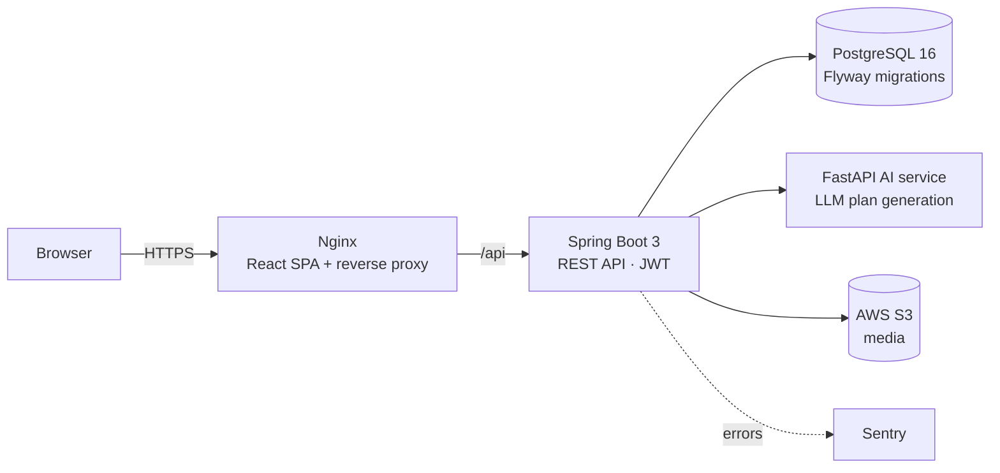

<h1 align="center">Viway Fitness Pro</h1>

<p align="center">
  AI fitness & nutrition coach — personalized workout and meal plans from your body profile, goals and budget.
</p>

<p align="center">
  <a href="https://app.viway.id.vn/"></a>
  
  
  
</p>

<!-- TODO: thay bằng ảnh chụp dashboard / trang kế hoạch (không dùng màn đăng nhập) -->
<p align="center"></p>

## Features

- **AI plan generation** — workout and meal plans generated by an LLM from body metrics, goal and budget
- **Body profile tracking** — weight, measurements and progress over time
- **Workout & nutrition** — exercise library, training plans, food database, meal logging
- **Challenges & rewards** — gamified challenges, points and transactions
- **Admin dashboard** — manage goals, plans, challenges, rewards, foods and nutrition data
- **AI pose analysis** — rep counting and form checks with MediaPipe (push-up, squat, pull-up, sit-up, plank)

## Architecture



Only Nginx is exposed publicly; the backend, AI service and database talk over the internal Docker network.

## Highlights

| | |
| --- | --- |
| REST API | 250+ endpoints across 50+ controllers, documented with OpenAPI / Swagger |
| Data model | 43 JPA entities, 37-table schema versioned with Flyway (schema + seed data) |
| Security | Spring Security + JWT, role-based access (user / admin) |
| Deployment | 4 services with Docker Compose, Nginx reverse proxy, GitHub Actions CI |
| Observability | Spring Boot Actuator health checks, Sentry error tracking |

## Tech stack

**Backend:** Java 17 · Spring Boot 3.5 · Spring Security · Spring Data JPA · Flyway · JWT (jjwt) · springdoc-openapi · AWS S3 SDK · Sentry
**AI services:** Python · FastAPI · LLM API (Groq) · MediaPipe
**Frontend:** React 18 · TypeScript · Vite · Tailwind CSS
**Infra:** PostgreSQL 16 · Docker Compose · Nginx · GitHub Actions

## Project structure

```
├── backend/              # Spring Boot REST API
├── frontend/             # React + Vite SPA
├── ai-service/           # FastAPI — LLM workout & meal plan generation
├── fitness-ai-service/   # FastAPI — MediaPipe pose analysis
├── deploy/ infra/        # Deployment configs
└── docs/                 # Architecture, API and deployment docs
```

## Run locally

Requirements: Docker and Docker Compose.

```bash
git clone https://github.com/Ducpham04/Nura_Fitness_Pro-ct.git
cd Nura_Fitness_Pro-ct
cp ai-service/.env.example ai-service/.env   # add your LLM API key
chmod +x ./dev.sh && ./dev.sh
```

| Service | URL |
| --- | --- |
| Frontend | http://localhost:5173 |
| Backend API | http://localhost:8080 |
| Swagger UI | http://localhost:8080/swagger-ui.html |
| Adminer (DB) | http://localhost:8081 |

Production deployment: see [DEPLOY.md](DEPLOY.md).

## Author

**Pham Van Duc** — Backend Developer · [GitHub](https://github.com/Ducpham04) · pvanduc0403@gmail.com
