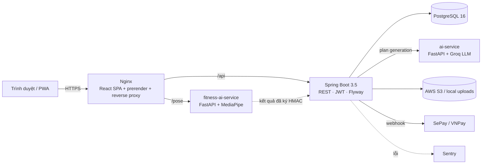
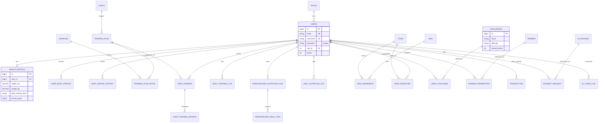
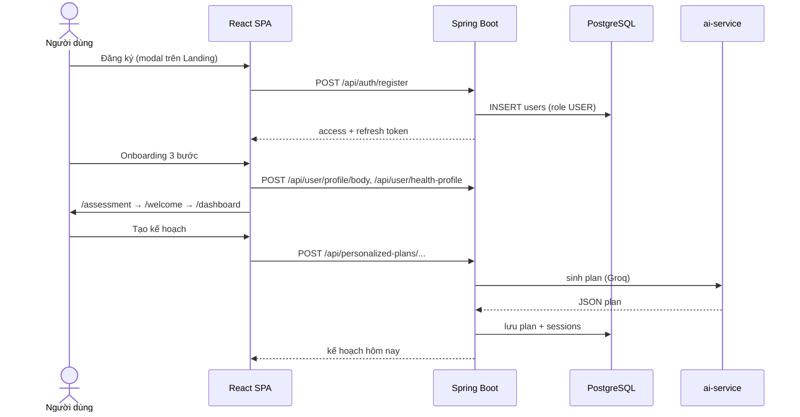

# Kiến trúc — Viway Fitness Pro

## 1. Tổng quan



| Thành phần | Công nghệ | Port local | Ghi chú |
| --- | --- | --- | --- |
| Frontend | React 18, TypeScript, Vite 5, Tailwind 3, React Router 7, framer-motion, i18next | 5173 | Route lazy-load, prerender trang công khai bằng Playwright |
| Backend | Java 17, Spring Boot 3.5, Spring Security, JPA, Flyway, springdoc | 8080 | Swagger: `/swagger-ui.html` |
| AI service | Python, FastAPI, Groq (OpenAI-compatible, có fallback provider) | 8011 → 8001 | Sinh kế hoạch ăn + tập |
| Pose service | Python, FastAPI, MediaPipe | 5001 | Đếm rep, chấm tư thế, ký kết quả HMAC |
| Database | PostgreSQL 16 | 5432 | 24 migration Flyway (schema + seed) |
| Adminer | DB UI | 8081 | Chỉ local |

Production chỉ public Nginx; backend, AI service, DB nói chuyện qua mạng Docker nội bộ.

## 2. ERD (rút gọn — thực thể cốt lõi)



Toàn bộ 43 entity nằm trong `backend/src/main/java/com/example/fitchallenge/Entity/`; schema chuẩn là `backend/src/main/resources/db/migration/V1__baseline_schema.sql`.

## 3. API (nhóm chính)

Chi tiết đầy đủ ở Swagger (`/swagger-ui.html`) và [api-rest-controller-report.md](api-rest-controller-report.md).

| Nhóm | Prefix | Quyền |
| --- | --- | --- |
| Xác thực | `POST /api/auth/register`, `/login`, `/refresh`, `/google`, `/forgot-password`, `/reset-password`; `GET /api/auth/me` | Public (trừ `/me`) |
| Hồ sơ | `/api/user/profile/body`, `/api/user/health-profile`, `/api/user/body-metric`, `/api/v1/users/{id}/profile` | USER (chỉ dữ liệu của chính mình) |
| Tập luyện | `/api/training-plans` (GET public), `/api/user/training`, `/api/user/daily-training-logs`, `/api/personalized-plans` | USER |
| Dinh dưỡng | `/api/daily-nutrition`, `/api/inventory`, `/api/budget`, `/api/food-analysis`, `/api/foods` (GET public) | USER |
| Thử thách & thưởng | `/api/challenges` (GET public), `/api/user/challenges`, `/api/leaderboard`, `/api/rewards`, `/api/reward-redemptions`, `/api/my/transactions` | USER |
| Gói AI & thanh toán | `/api/ai-packages` (GET public), `/api/ai-usage`, `/api/ai-packages/payment/webhook` (xác thực HMAC/API key) | USER / webhook |
| File | `GET /api/files/**` public; `POST /api/files/upload-*` | GET public, upload cần đăng nhập |
| Quản trị | `/api/admin/**` (users, goals, exercises, dishes, training-plans, challenges, rewards, dashboard, ai, seeder) | ADMIN |
| Health | `/actuator/health`, `/actuator/info` | Public |

## 4. Phân quyền

| Role | ID | Phạm vi |
| --- | --- | --- |
| `ADMIN` | 1 | Toàn quyền, gồm `/api/admin/**`, duyệt thanh toán, đổi quà |
| `USER` | 2, 5 | Dữ liệu của chính mình. Các endpoint nhận `userId` trên URL được ép về user đang đăng nhập qua `AuthenticatedUserIdResolver` |
| `EDITOR` | 3 | Vào trang quản trị nhưng UI chỉ hiện tab nội dung (bài tập, món ăn, giáo án) |

- JWT HS256: access token (mặc định 24h, `JWT_EXPIRATION`) + refresh token; secret từ `JWT_SECRET` (≥ 32 ký tự).
- Mật khẩu BCrypt. CORS whitelist qua `CORS_ALLOWED_ORIGINS`.
- Kết quả thử thách từ pose service được ký HMAC (`POSE_SIGNING_SECRET`) để chống gian lận điểm.

## 5. Cấu trúc thư mục

```
├── backend/                     # Spring Boot
│   └── src/main/java/com/example/fitchallenge/
│       ├── Entity/  DTO/  repository/  service/ (+impl/)
│       ├── controller/{Admin,User,UserChallenge}/
│       ├── Security/ (JWT, SecurityConfig, CorsConfig)
│       └── resources/db/migration/   # Flyway V1..V24
├── frontend/                    # React SPA
│   ├── src/{pages,components,services,hooks,context,config,i18n,lib}
│   ├── e2e/                     # Playwright
│   └── scripts/prerender.mjs    # bake HTML tĩnh cho SEO
├── ai-service/                  # FastAPI + Groq (plan generation)
├── fitness-ai-service/          # FastAPI + MediaPipe (pose)
├── deploy/ infra/               # Caddy/EC2/ECS configs
├── docker-compose.local.yml     # stack local (./dev.sh)
└── docker-compose.prod.yml      # stack production
```

## 6. Luồng chính (end-to-end)


