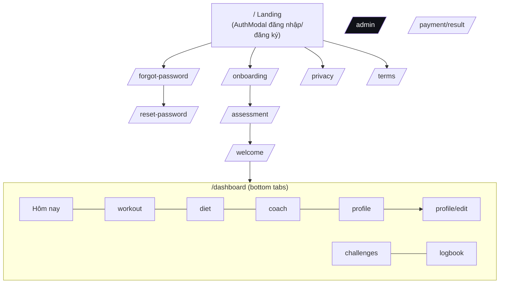

# Thiết kế UI/UX — Viway

> Design tokens nguồn nằm ở [`/DESIGN.md`](../DESIGN.md) (định dạng máy đọc) và `frontend/tailwind.config.js`.
> Tài liệu này mô tả hệ thống cho người đọc: nguyên tắc, sitemap, từng màn hình.

## 1. Nguyên tắc

- **Mobile-first**: thiết kế cho 375px, mở rộng ở 768px (tablet) và 1280px (desktop).
- **Chính xác · năng lượng · cao cấp** cho app người dùng; **bình tĩnh · đọc nhanh** cho trang quản trị.
- Tiếng Việt là ngôn ngữ chính (i18next, có tiếng Anh).
- Dark mode mặc định, có light mode (lưu `localStorage.viway-theme`, set class trước khi render để không nháy).
- Tránh: neon tràn lan, glassmorphism nặng, card bo tròn quá mức, dashboard giả số liệu.

## 2. Design system

### Màu
| Token | Giá trị | Dùng cho |
| --- | --- | --- |
| `obsidian` | `#050505` | Nền app (dark) |
| `charcoal` / `surface` | `#121216` / `#18181C` | Card, panel |
| `lime` (primary) | `#CCFF00` | CTA chính, trạng thái active — luôn đi với chữ tối `#050505` |
| `electric` | `#007AFF` | Link, accent phụ |
| `success` / `warning` / `danger` | `#30D158` / `#FF9500` / `#FF3B30` | Trạng thái |
| `text-primary` / `secondary` / `muted` | `#F8F8F8` / `#A0A0A0` / `#707070` | Chữ (muted chỉ cho chữ ≥ 14px) |
| Admin | `#0a0b0e` nền, slate-100…500 chữ, emerald accent | Trang quản trị |

Tương phản: chữ thường ≥ 4.5:1, chữ lớn/icon ≥ 3:1 (đã audit bằng axe-core).

### Typography
| Vai trò | Font | Size / weight |
| --- | --- | --- |
| Display | Space Grotesk | 32px / 700 |
| Headline | Space Grotesk | 24px / 700 |
| Title | Space Grotesk | 18px / 700 |
| Body | Inter | 14px / 400, line-height 1.5 |
| Label | Inter | 12px / 700, uppercase, tracking 0.12em |

### Spacing & bo góc
- Thang spacing 4px: 4 · 8 · 12 · 16 · 24 · 32 · 48.
- Bo góc: 8 (input nhỏ) · 12 (nút) · 16 (card) · 24 (hero card).
- Gutter trang: 16px mobile, 24px tablet, 40px desktop.

### Component chính
| Component | File | Ghi chú |
| --- | --- | --- |
| Logo | `components/Logo.tsx` | Mark + wordmark, dark/light |
| Navigation | `components/Navigation.tsx` | Top bar desktop; header + bottom tab bar mobile |
| AuthModal | `components/AuthModal.tsx` | Đăng nhập/đăng ký/Google trên Landing |
| ProgressRing, MacroRadial, TrendChart | `components/*` | Biểu đồ tiến độ (recharts) |
| AiUsageBadge, AiUpgradeModal | `components/*` | Hạn mức AI + nâng cấp VietQR |
| EmptyState, LoadingState, ErrorBoundary | `components/*` | Trạng thái rỗng/tải/lỗi |
| Admin NavItem + drawer | `pages/AdminPanel.tsx` | Sidebar desktop, drawer < 1024px |

## 3. Sitemap

## 4. Màn hình

| Màn hình | Route | Mục đích | Thành phần chính | Mobile |
| --- | --- | --- | --- | --- |
| Landing | `/` | Giới thiệu, chuyển đổi đăng ký | Hero + ảnh tập, tính năng, showcase, bảng giá, FAQ, AuthModal | Menu hamburger, CTA full-width |
| Onboarding | `/onboarding` | Thu thập hồ sơ (3 bước) | Chọn giới tính, wheel picker tuổi/cân/chiều cao, mức vận động, mục tiêu | Một cột, nút "Tiếp tục" cố định |
| Assessment | `/assessment` | BMI/BMR/TDEE | Thang BMI, chỉ số, CTA tiếp tục | Card xếp dọc |
| Hôm nay | `/dashboard` | Tổng quan ngày | Hero chào, bài tập hôm nay, calo/macro, streak | Bottom tab bar |
| Tập luyện | `/dashboard/workout` | Giáo án & buổi tập | Lịch tuần, danh sách bài, hướng dẫn, đánh dấu hoàn thành | Danh sách cuộn, sheet chi tiết |
| Dinh dưỡng | `/dashboard/diet` | Thực đơn theo ngân sách | Thực đơn tuần, ngân sách còn lại, ghi bữa, quét ảnh, tủ lạnh | Tabs ngày cuộn ngang |
| Thử thách | `/dashboard/challenges` | Động lực & điểm | Danh sách thử thách, camera chấm điểm, bảng xếp hạng, đổi quà | Card ảnh 1 cột |
| AI Coach | `/dashboard/coach` | Hỏi đáp | Chat, gợi ý câu hỏi | Input cố định đáy |
| Hồ sơ | `/dashboard/profile` | Thông tin & thành tích | Chỉ số cơ thể, thành tích, gói AI, đăng xuất | 1 cột |
| Nhật ký | `/dashboard/logbook` | Lịch sử buổi tập | Thống kê, lọc, danh sách log | 1 cột |
| Quản trị | `/admin` | Vận hành | Tổng quan DAU/MAU/doanh thu, CRUD bảng, thanh toán, cấu hình | Drawer menu, bảng cuộn ngang |
| Pháp lý | `/privacy`, `/terms` | Chính sách | Văn bản | 1 cột |

## 5. Breakpoints đã kiểm thử

375px, 768px, 1280px trên toàn bộ route công khai, user và admin bằng Playwright:
không tràn ngang và không phần tử bị cắt (xem [TEST_PLAN.md](TEST_PLAN.md)).
